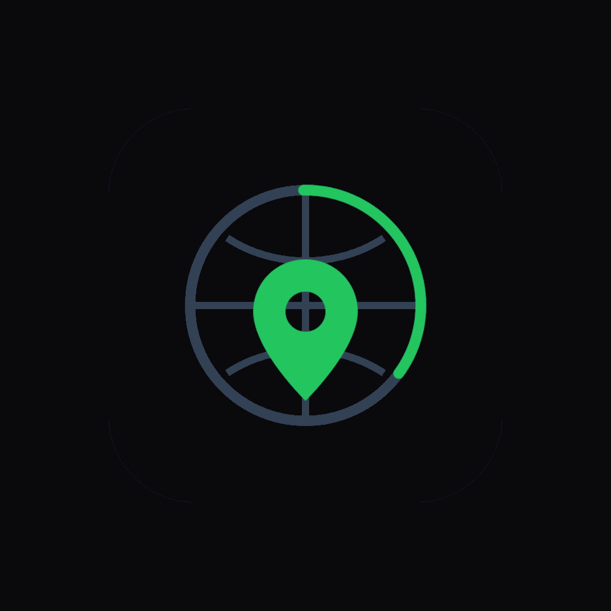
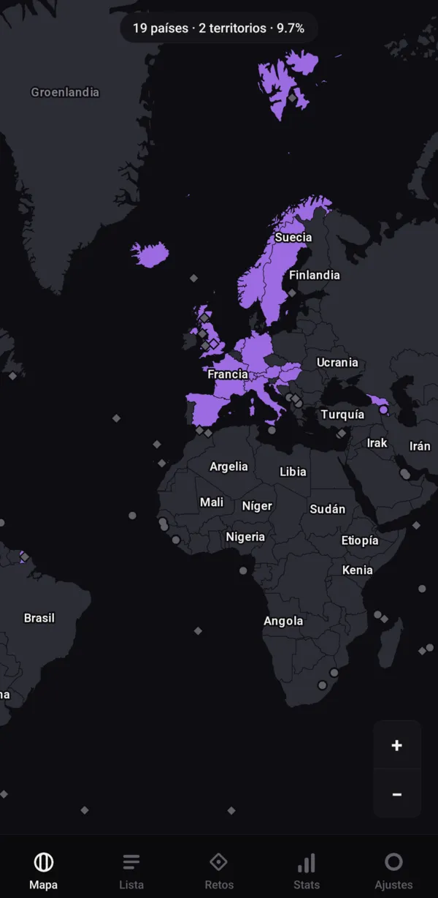
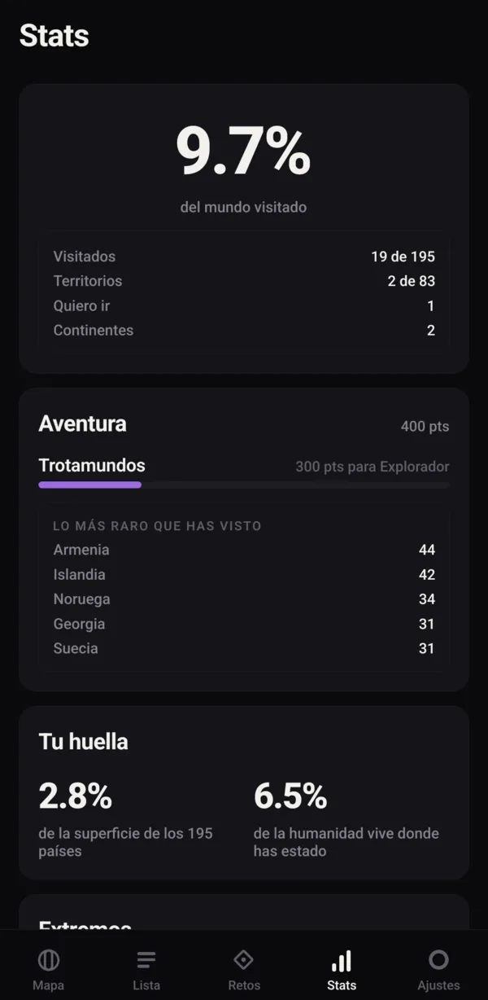

<div align="center">



# Ludok Been

**Track every country you've visited on an interactive world map, right on your phone.**

Mark where you've been and where you want to go, and see how much of the world you've seen.<br>
Your data lives on your phone. No accounts. No servers. No tracking.

[](LICENSE)
[](https://docs.expo.dev/versions/v57.0.0/)
[](https://reactnative.dev/)
[](https://www.typescriptlang.org/)
[](https://github.com/iamLudok/Ludok-been/releases)
[](https://docs.expo.dev/versions/v57.0.0/sdk/sqlite/)

[Features](#features) · [Download](#download) · [Build](#building-from-source) · [Backups](#backups) · [License](#license)

</div>

---

<p align="center">
&nbsp;

</p>

<p align="center"><sub>Map · Stats</sub></p>

## Table of Contents

- [Why Ludok Been?](#why-ludok-been)
- [Features](#features)
- [Download](#download)
- [Backups](#backups)
- [Building from Source](#building-from-source)
- [How It's Tested](#how-its-tested)
- [Project Structure](#project-structure)
- [Data Sources & Credits](#data-sources--credits)
- [Contributing](#contributing)
- [License](#license)

---

## Why Ludok Been?

Apps like [been](https://been.app) are great, but they want an account and keep your travel
history on their servers. Ludok Been does the same job **for free, without an account, and
entirely on your phone**.

- 📱 **Local-first**: everything is stored in a SQLite database inside the app. No accounts, no cloud, no analytics.
- 💾 **Backups**: export everything to a single JSON file and import it on any phone.
- ☁️ **Automatic Nextcloud backup** (optional): uploads a copy to your own Nextcloud when you open the app on WiFi.
- 🧪 **Tested logic**: the data layer and the map maths are tested in Node, without a phone (see [below](#how-its-tested)).

> **What leaves your phone:** nothing, unless you set up the Nextcloud backup. If you do, the
> backup goes straight to your server and nowhere else.

---

## Features

- 🗺️ **Interactive world map**: tap a country to mark it, drag to move around (with inertia), and zoom with the + and − buttons. The map wraps horizontally, so you can keep scrolling past the Pacific. It's drawn with Skia, so it stays sharp up to 60× zoom.
- 📍 **Tiny countries are tappable**: countries too small to hit with a finger (Vatican City, Monaco, Tuvalu…) get a dot on the map.
- 🎯 **Selected country stands out**: tapping a country frames it above its card, with a highlighted outline, and the map stays usable underneath.
- ✅ **Two states per place**: **Visited** or **Want to go**, with an optional year.
- 🚆 **How you got around**: mark the transport you used in each country (plane, train, car, bus, boat, motorbike, bike, on foot) or type your own.
- 📋 **List**: countries grouped by continent and territories grouped by type, with search.
- 📊 **Stats**: countries visited out of 195, territories visited, % of the world, continents visited, a breakdown by continent and by transport.
- 🏔️ **Adventure points**: every place has a rarity score from 1 (France, the most visited country) to 100 (Tuvalu), based on international tourist arrivals on a log scale. Your total gives you a level, from *Turista* to *Leyenda*, and Stats shows the rarest places you've been.
- 👣 **Your footprint**: the % of the 195 countries' land area you've set foot in, and the % of humanity that lives where you've been.
- 🧭 **Extremes**: the northernmost, southernmost, easternmost and westernmost places you've been, and, once you pick your home country, the farthest one from home in km. Measured from the centre of each place, so Svalbard counts but visiting Russia doesn't put you in the Arctic.
- 🎖️ **Challenges**: 16 achievements shown as passport stamps, with progress: a state that doesn't exist (Transnistria, Abkhazia…), Europe's microstates, the Crown Dependencies, the Balkans, the Caucasus, all continents, a chain of 10 countries crossing land borders, 10 places by train… You get a notice the first time you unlock each one.
- 🏆 **Ranking**: countries sorted by rarity, area or population, filtered by visited or still missing (in the *Retos* tab).
- 🌍 **Countries and territories, kept apart**: the **195 countries** are the 193 UN members plus its two observers (Vatican City and Palestine), and they're the only thing your world % counts. Everything else worth marking is a **territory**, with its own counter: de facto states (Transnistria, Abkhazia, Somaliland…), the UK nations, singular regions (Basque Country, Canary Islands, Tibet, Galápagos…), dependencies (Gibraltar, Faroe Islands, Isle of Man…), overseas departments and remote islands.
- 🧭 **Clear rule for what counts**: a territory adds its country only if it's part of it. Scotland counts towards the UK and the Canary Islands towards Spain, but Gibraltar doesn't count towards the UK and Martinique doesn't count towards France.
- 🌗 **Dark and light theme**, selectable in *Ajustes → Tema*.
- ⚠️ **Backup reminder** on the map if you haven't made a backup in 7 days.

The app's interface is in Spanish.

---

## Download

Grab the latest signed APK from the [Releases](https://github.com/iamLudok/Ludok-been/releases) page
and install it on your Android phone (you'll need to allow installing apps from unknown sources).

Updates install **on top of** the previous version and keep your data, as long as they come from
the same Releases page (same signing key).

---

## Backups

The app starts empty, and your data only exists on your phone, so back it up.

### Manual backup

**Ajustes → Copia de seguridad → Exportar copia** exports everything to a single JSON file and opens
the share menu, so you can save it to Files, Nextcloud, Drive or wherever you want.
**Importar copia** restores a backup, **replacing** the current data.

### Automatic backup to Nextcloud

In **Ajustes → Copia automática a Nextcloud**, enter your server URL, user, password and folder.
When you open the app on WiFi, it uploads a backup at most once every 12 hours, with one file per day.

- Use a Nextcloud **[app password](https://docs.nextcloud.com/server/latest/user_manual/en/session_management.html#managing-devices)**, not your account password, so you can revoke it at any time.
- That password is **never included in exported backups**, since a backup is meant to be shared and moved around. A test in `verify:data` checks this.
- No background task is used on purpose: Android kills them silently, and you'd never know whether they worked.

> The app allows plain `http://` traffic (`usesCleartextTraffic`) so it can reach a Nextcloud on your
> home network. Use HTTPS or a VPN if your server is reachable from outside.

---

## Building from Source

### Requirements

- Node.js and npm
- JDK 17
- Android SDK with API 36, and `adb`
- An Android phone connected over USB (or an emulator)

### Run in development

```bash
git clone https://github.com/iamLudok/Ludok-been.git
cd Ludok-been
npm install
npm run android      # builds, installs and opens the app on a phone connected via adb
npm run typecheck    # types for the app and the verification scripts
npm run verify       # tests the data layer and the map maths
```

> Gradle needs a **Java 17** toolchain. If it fails with *"Cannot find a Java installation matching
> languageVersion=17"* while you have a newer JDK, point it to the one Gradle already downloaded:
>
> ```bash
> export JAVA_HOME=~/.gradle/jdks/eclipse_adoptium-17-amd64-linux.2
> ```

### Build a release APK

The build script signs the APK with your own keystore. Create one and describe it in a
`keystore.properties` file at the project root (both are in `.gitignore`):

```bash
keytool -genkeypair -v -keystore release.jks -alias ludok-been \
  -keyalg RSA -keysize 2048 -validity 10000
```

```properties
storeFile=release.jks
storePassword=...
keyAlias=ludok-been
keyPassword=...
```

Then:

```bash
npm run build:apk                    # all architectures
./scripts/build-apk.sh --compartir   # arm64-v8a only, smaller, for sharing
# → android/app/build/outputs/apk/release/app-release.apk

adb install -r android/app/build/outputs/apk/release/app-release.apk
```

It has to be a **release** build: a debug APK loads its JavaScript from the Metro server, so it
doesn't work without your computer.

> ⚠️ **Keep your keystore safe.** Android only installs an APK on top of another if both are signed
> with the same key. If you lose it, the only way to install a new version is to uninstall the
> app, and **uninstalling deletes its data**. It's the one thing in this project that can't be
> regenerated.

---

## How It's Tested

The parts that are easy to break and hard to check by hand are tested in Node, running **the same
code that runs on the phone**:

```bash
npm run verify:data       # backup round trip (export/import), password never exported
npm run verify:library    # rules: visit status, transports, stats, territories, rarity, achievements, extremes
npm run verify:migration  # the schema is created idempotently
npm run verify:map        # pan, zoom and camera maths; every country is tappable
```

The data tests run against a desktop SQLite through **libsql**, which, like `expo-sqlite`, supports
async transactions. The logic gets its database from [`src/lib/dbRef.ts`](src/lib/dbRef.ts) instead
of creating it, and [`src/lib/db.ts`](src/lib/db.ts) is the **only** file that touches `expo-sqlite`.

The map test checks that zooming keeps **the point at the centre of the screen in place**, that
the map doesn't jump when a finger is added or lifted, and that the camera frames the selected
country. Those bugs are invisible when reading the code and slow to test by hand (build, install,
drag), so they're tested on the pure functions in [`src/lib/mapTransform.ts`](src/lib/mapTransform.ts),
replaying finger sequences. It also checks that **every country can be tapped**, at world view and
zoomed in.

---

## Project Structure

```
Ludok-been/
├── app/                    ← Routes (expo-router)
│   ├── (tabs)/             ← Map, List, Challenges, Stats, Settings
│   └── ranking.tsx         ← Country ranking
├── src/
│   ├── lib/                ← Data and logic (SQLite, Drizzle, backups, Nextcloud, map maths)
│   ├── data/               ← Country metadata and projected map geometry (generated, committed)
│   ├── ui/                 ← Design tokens and base components
│   ├── components/         ← WorldMap, CountrySheet, BackupBanner, NextcloudSettings
│   └── hooks/              ← Reactive queries (Drizzle's useLiveQuery)
├── verify/                 ← Tests (Node, not shipped in the APK)
├── scripts/
│   ├── build-apk.sh        ← Builds and signs the release APK
│   ├── gen-countries.mjs   ← Regenerates src/data/countries.json
│   └── gen-map.mjs         ← Regenerates src/data/map.json (projected geometry)
├── assets/                 ← Icon and splash screen
├── app.json                ← Expo configuration
└── package.json
```

The `android/` folder is generated by `expo prebuild` and is not committed.

### Country data

[`src/data/countries.json`](src/data/countries.json) is generated from the `world-countries` package
plus the hand-written territories in [`src/data/territories.json`](src/data/territories.json) (the
ones with no ISO code, like Transnistria or the Basque Country), and committed, so the app doesn't
depend on `world-countries` at runtime. Which territory depends on which country, and which ones
count towards it, is set in [`scripts/gen-countries.mjs`](scripts/gen-countries.mjs). Codes of
hand-written territories start with `x-` so they never clash with an ISO code; they're stored in
backups, so **never rename one**. To regenerate:

```bash
npm run gen:countries
npm run gen:map          # after changing countries.json or the UK nation shapes
```

[`src/data/map.json`](src/data/map.json) holds the map geometry **already projected** to screen
coordinates, so the app ships neither d3 nor the atlas and hit-testing is plain point-in-polygon.

---

## Data Sources & Credits

- **Country metadata** (names, codes, continents) comes from [mledoze/countries](https://github.com/mledoze/countries) (`world-countries`), licensed under the [Open Database License (ODbL) 1.0](https://opendatacommons.org/licenses/odbl/1-0/). The derived file [`src/data/countries.json`](src/data/countries.json) is distributed under the same license.
- **Tourist arrivals and population** come from the [World Bank's World Development Indicators](https://datacatalog.worldbank.org/search/dataset/0037712/World-Development-Indicators) (`ST.INT.ARVL`, sourced from UN Tourism, and `SP.POP.TOTL`), licensed under [CC BY 4.0](https://creativecommons.org/licenses/by/4.0/). Arrivals use the latest year up to 2019, since 2020 is distorted by COVID, and are stored rounded in [`src/data/indicators.json`](src/data/indicators.json) (`npm run gen:indicators`). Countries with no data and most territories get a hand-set rarity, listed in [`src/lib/rarity.ts`](src/lib/rarity.ts).
- **Map geometry** comes from [Natural Earth](https://www.naturalearthdata.com/) 1:50m (public domain), through [world-atlas](https://github.com/topojson/world-atlas). The UK nation shapes in [`src/data/uk-nations.json`](src/data/uk-nations.json) are cut from Natural Earth's 1:50m map subunits.
- The geometry is projected at build time with [d3-geo](https://github.com/d3/d3-geo) and [topojson-client](https://github.com/topojson/topojson-client), and drawn on the phone with [React Native Skia](https://github.com/Shopify/react-native-skia).

---

## Contributing

Pull requests are welcome. See [CONTRIBUTING.md](CONTRIBUTING.md) for the development setup and
conventions. To report a security vulnerability, follow [SECURITY.md](SECURITY.md) instead of
opening a public issue.

---

## License

The code is distributed under the **MIT License**. You are free to use, modify and share Ludok Been,
including for commercial use, as long as you keep the copyright notice. See [LICENSE](LICENSE) for
the full text.

The country data in `src/data/countries.json` is licensed separately under the ODbL (see
[Data Sources & Credits](#data-sources--credits)).

---

<div align="center">

Made by [Luken Iriondo](https://github.com/iamLudok) · If Ludok Been is useful to you, consider giving it a ⭐

</div>
