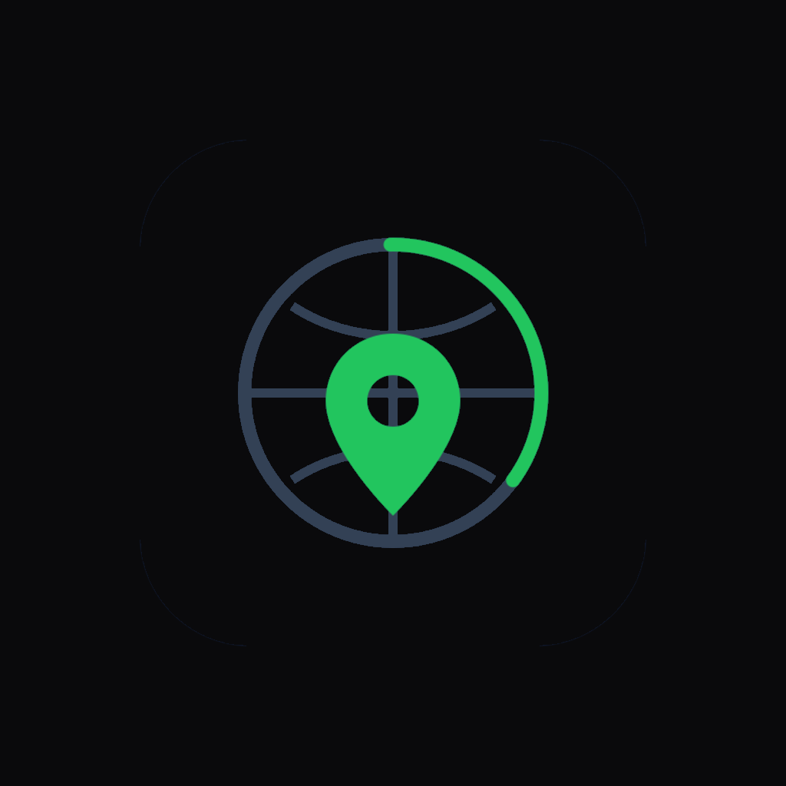

<div align="center">



# Ludok Been

**Track every country you've visited on an interactive world map, right on your phone.**

Mark where you've been and where you want to go, and see how much of the world you've seen.<br>
Your data lives on your phone. No accounts. No servers. No tracking.

[](LICENSE)
[](https://docs.expo.dev/versions/v57.0.0/)
[](https://reactnative.dev/)
[](https://www.typescriptlang.org/)
[](https://github.com/iamLudok/Ludok-been/releases)
[](https://docs.expo.dev/versions/v57.0.0/sdk/sqlite/)

[Features](#features) · [Download](#download) · [Build](#building-from-source) · [Backups](#backups) · [License](#license)

</div>

---

<!--
## Screenshots

<p align="center">
  
  
  
</p>
-->

## Table of Contents

- [Why Ludok Been?](#why-ludok-been)
- [Features](#features)
- [Download](#download)
- [Backups](#backups)
- [Building from Source](#building-from-source)
- [How It's Tested](#how-its-tested)
- [Project Structure](#project-structure)
- [Data Sources & Credits](#data-sources--credits)
- [Contributing](#contributing)
- [License](#license)

---

## Why Ludok Been?

Apps like [been](https://been.app) are great, but they want an account and keep your travel
history on their servers. Ludok Been does the same job **for free, without an account, and
entirely on your phone**.

- 📱 **Local-first**: everything is stored in a SQLite database inside the app. No accounts, no cloud, no analytics.
- 💾 **Backups**: export everything to a single JSON file and import it on any phone.
- ☁️ **Automatic Nextcloud backup** (optional): uploads a copy to your own Nextcloud when you open the app on WiFi.
- 🧪 **Tested logic**: the data layer and the map maths are tested in Node, without a phone (see [below](#how-its-tested)).

> **What leaves your phone:** nothing, unless you set up the Nextcloud backup. If you do, the
> backup goes straight to your server and nowhere else.

---

## Features

- 🗺️ **Interactive world map**: tap a country to mark it, pinch to zoom, drag to move around. The map wraps horizontally, so you can keep scrolling past the Pacific.
- ✅ **Two states per country**: **Visited** or **Want to go**, with an optional year.
- 🚆 **How you got around**: mark the transport you used in each country (plane, train, car, bus, boat, motorbike, bike, on foot) or type your own.
- 📋 **List**: every country grouped by continent, with search.
- 📊 **Stats**: countries visited out of the world total, % of the world, continents visited, a breakdown by continent and by transport.
- 🇬🇧 **UK nations**: England, Scotland, Wales and Northern Ireland can be marked separately, but together they count as one country towards your world %.
- 🌗 **Dark and light theme**, selectable in *Ajustes → Tema*.
- ⚠️ **Backup reminder** on the map if you haven't made a backup in 7 days.

The app's interface is in Spanish.

---

## Download

Grab the latest signed APK from the [Releases](https://github.com/iamLudok/Ludok-been/releases) page
and install it on your Android phone (you'll need to allow installing apps from unknown sources).

Updates install **on top of** the previous version and keep your data, as long as they come from
the same Releases page (same signing key).

---

## Backups

The app starts empty, and your data only exists on your phone, so back it up.

### Manual backup

**Ajustes → Copia de seguridad → Exportar copia** exports everything to a single JSON file and opens
the share menu, so you can save it to Files, Nextcloud, Drive or wherever you want.
**Importar copia** restores a backup, **replacing** the current data.

### Automatic backup to Nextcloud

In **Ajustes → Copia automática a Nextcloud**, enter your server URL, user, password and folder.
When you open the app on WiFi, it uploads a backup at most once every 12 hours, with one file per day.

- Use a Nextcloud **[app password](https://docs.nextcloud.com/server/latest/user_manual/en/session_management.html#managing-devices)**, not your account password, so you can revoke it at any time.
- That password is **never included in exported backups**, since a backup is meant to be shared and moved around. A test in `verify:data` checks this.
- No background task is used on purpose: Android kills them silently, and you'd never know whether they worked.

> The app allows plain `http://` traffic (`usesCleartextTraffic`) so it can reach a Nextcloud on your
> home network. Use HTTPS or a VPN if your server is reachable from outside.

---

## Building from Source

### Requirements

- Node.js and npm
- JDK 17
- Android SDK with API 36, and `adb`
- An Android phone connected over USB (or an emulator)

### Run in development

```bash
git clone https://github.com/iamLudok/Ludok-been.git
cd Ludok-been
npm install
npm run android      # builds, installs and opens the app on a phone connected via adb
npm run typecheck    # types for the app and the verification scripts
npm run verify       # tests the data layer and the map maths
```

> Gradle needs a **Java 17** toolchain. If it fails with *"Cannot find a Java installation matching
> languageVersion=17"* while you have a newer JDK, point it to the one Gradle already downloaded:
>
> ```bash
> export JAVA_HOME=~/.gradle/jdks/eclipse_adoptium-17-amd64-linux.2
> ```

### Build a release APK

The build script signs the APK with your own keystore. Create one and describe it in a
`keystore.properties` file at the project root (both are in `.gitignore`):

```bash
keytool -genkeypair -v -keystore release.jks -alias ludok-been \
  -keyalg RSA -keysize 2048 -validity 10000
```

```properties
storeFile=release.jks
storePassword=...
keyAlias=ludok-been
keyPassword=...
```

Then:

```bash
npm run build:apk                    # all architectures
./scripts/build-apk.sh --compartir   # arm64-v8a only, smaller, for sharing
# → android/app/build/outputs/apk/release/app-release.apk

adb install -r android/app/build/outputs/apk/release/app-release.apk
```

It has to be a **release** build: a debug APK loads its JavaScript from the Metro server, so it
doesn't work without your computer.

> ⚠️ **Keep your keystore safe.** Android only installs an APK on top of another if both are signed
> with the same key. If you lose it, the only way to install a new version is to uninstall the
> app, and **uninstalling deletes its data**. It's the one thing in this project that can't be
> regenerated.

---

## How It's Tested

The parts that are easy to break and hard to check by hand are tested in Node, running **the same
code that runs on the phone**:

```bash
npm run verify:data       # backup round trip (export/import), password never exported
npm run verify:library    # rules: visit status, year, transports, stats
npm run verify:migration  # the schema is created idempotently
npm run verify:map        # pinch, pan and zoom maths
```

The data tests run against a desktop SQLite through **libsql**, which, like `expo-sqlite`, supports
async transactions. The logic gets its database from [`src/lib/dbRef.ts`](src/lib/dbRef.ts) instead
of creating it, and [`src/lib/db.ts`](src/lib/db.ts) is the **only** file that touches `expo-sqlite`.

The map test checks the property that defines a correct pinch: **the point of the map under your
fingers doesn't move**. That bug is invisible when reading the code and slow to test by hand
(build, install, pinch), so it's tested on the pure functions in
[`src/lib/mapTransform.ts`](src/lib/mapTransform.ts).

---

## Project Structure

```
Ludok-been/
├── app/                    ← Routes (expo-router)
│   └── (tabs)/             ← Map, List, Stats, Settings
├── src/
│   ├── lib/                ← Data and logic (SQLite, Drizzle, backups, Nextcloud, map maths)
│   ├── data/               ← Country metadata and UK nation shapes (generated, committed)
│   ├── ui/                 ← Design tokens and base components
│   ├── components/         ← WorldMap, CountrySheet, BackupBanner, NextcloudSettings
│   └── hooks/              ← Reactive queries (Drizzle's useLiveQuery)
├── verify/                 ← Tests (Node, not shipped in the APK)
├── scripts/
│   ├── build-apk.sh        ← Builds and signs the release APK
│   └── gen-countries.mjs   ← Regenerates src/data/countries.json
├── assets/                 ← Icon and splash screen
├── app.json                ← Expo configuration
└── package.json
```

The `android/` folder is generated by `expo prebuild` and is not committed.

### Country data

[`src/data/countries.json`](src/data/countries.json) is generated from the `world-countries` package
and committed, so the app doesn't depend on it at runtime. To regenerate it:

```bash
npm run gen:countries
```

---

## Data Sources & Credits

- **Country metadata** (names, codes, continents) comes from [mledoze/countries](https://github.com/mledoze/countries) (`world-countries`), licensed under the [Open Database License (ODbL) 1.0](https://opendatacommons.org/licenses/odbl/1-0/). The derived file [`src/data/countries.json`](src/data/countries.json) is distributed under the same license.
- **Map geometry** comes from [Natural Earth](https://www.naturalearthdata.com/) (public domain), through [world-atlas](https://github.com/topojson/world-atlas). The UK nation shapes in [`src/data/uk-nations.json`](src/data/uk-nations.json) are cut from Natural Earth's 1:50m map subunits.
- Map rendering uses [d3-geo](https://github.com/d3/d3-geo) and [topojson-client](https://github.com/topojson/topojson-client).

---

## Contributing

Pull requests are welcome. See [CONTRIBUTING.md](CONTRIBUTING.md) for the development setup and
conventions. To report a security vulnerability, follow [SECURITY.md](SECURITY.md) instead of
opening a public issue.

---

## License

The code is distributed under the **MIT License**. You are free to use, modify and share Ludok Been,
including for commercial use, as long as you keep the copyright notice. See [LICENSE](LICENSE) for
the full text.

The country data in `src/data/countries.json` is licensed separately under the ODbL (see
[Data Sources & Credits](#data-sources--credits)).

---

<div align="center">

Made by [Luken Iriondo](https://github.com/iamLudok) · If Ludok Been is useful to you, consider giving it a ⭐

</div>
